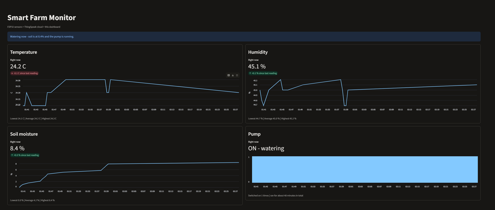
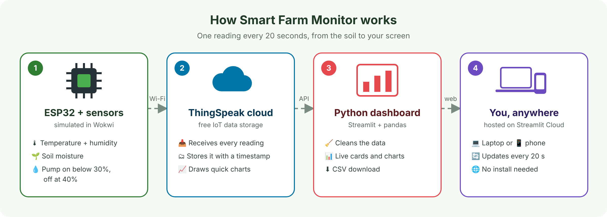
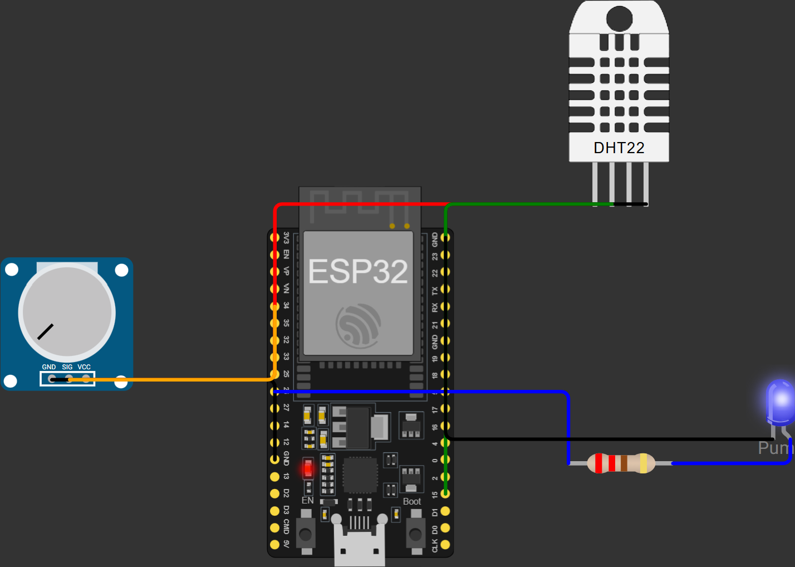

# 🌱 Smart Farm Monitor

**ESP32 → ThingSpeak cloud → Python dashboard**

A small IoT project that keeps an eye on a garden bed. An ESP32 reads the soil moisture, temperature and humidity, switches a pump on when the soil gets dry, and sends everything to the ThingSpeak cloud every 20 seconds. A Python dashboard then pulls the data back down and shows it live.


### 👉 [See the live dashboard](https://smart-farm-monitor.streamlit.app/)

No install needed. It runs online on Streamlit Community Cloud and works on your phone too. If it's been quiet for a while, click **"Yes, get this app back up"** and it'll wake up in a few seconds.

📊 **Raw data:** [ThingSpeak channel 3593878](https://thingspeak.mathworks.com/channels/3593878)

[](https://smart-farm-monitor.streamlit.app/)

---

## How it works



1. **The ESP32** reads its sensors every 20 seconds.
2. **It decides about watering by itself:** the pump turns on when the soil drops below **30%** and keeps going until it's back up to **40%**, so it runs steadily instead of flicking on and off. This keeps working even if the internet drops.
3. **ThingSpeak** stores every reading in the cloud.
4. **The dashboard** fetches the latest readings and tidies them up with pandas. It shows a card for each reading (temperature, humidity, soil moisture and the pump), each with its value right now, the change since the last reading, its own chart that zooms in automatically so small changes are easy to see, and the lowest, average and highest values. There's also a table of the latest readings and a CSV download. It's hosted on **Streamlit Community Cloud**, so it's always online at [smart-farm-monitor.streamlit.app](https://smart-farm-monitor.streamlit.app/).

Wokwi's sensors sit still unless you move them, so the code adds small, natural changes (a tenth of a degree here, a little drying there) to make the data behave like a real field. One setting, `NATURAL_CHANGES = False`, switches this off for a real board.

## The circuit

| Part | ESP32 pin | Job |
|---|---|---|
| DHT22 | GPIO 15 | Temperature and humidity |
| Potentiometer (knob) | GPIO 34 | Stands in for the soil moisture sensor |
| Blue LED + 220 Ω resistor | GPIO 26 | Stands in for the pump |



## What's in the folder

| File | What it is |
|---|---|
| `wokwi/diagram.json` | The circuit |
| `wokwi/main.py` | The ESP32 code (MicroPython) |
| `dashboard/app.py` | The dashboard |
| `dashboard/send_test_data.py` | Sends 5 test readings, so you can check everything before using Wokwi |
| `Start Dashboard.bat` | Double-click to open the dashboard on Windows |
| `.env.example` | Template for your private keys |

---

## Run it yourself

**1. ThingSpeak:** make a free channel at [thingspeak.mathworks.com](https://thingspeak.mathworks.com) with 4 fields: `Temperature`, `Humidity`, `Soil moisture`, `Pump`. Note your **Channel ID**, **Write API Key** and **Read API Key**.

**2. Your settings:** open `dashboard/app.py` and put your **Channel ID** in `CHANNEL_ID` at the top. Add the **Read API Key** in `READ_API_KEY` only if your channel is private. For the test sender, copy `.env.example` to `.env` and add your Write API Key; that file stays on your computer and never goes to GitHub.

**3. The dashboard:** just want to look? Open the [live version](https://smart-farm-monitor.streamlit.app/). To run your own copy on your PC, double-click **`Start Dashboard.bat`**. Or from a terminal:
```bash
python -m venv .venv
.venv\Scripts\activate
pip install -r requirements.txt
streamlit run dashboard/app.py
```

**4. The ESP32:** on [wokwi.com](https://wokwi.com), start a **New Project → ESP32 → MicroPython**. Paste in `diagram.json` and `main.py`, add your Write API Key, and press ▶ **Play**. A new reading appears on the dashboard every 20 seconds.

Want to check the cloud side first? Run `python dashboard/send_test_data.py`.

**5. Put your own copy online (optional):** on [share.streamlit.io](https://share.streamlit.io), create an app from your fork with the main file `dashboard/app.py`. It reads the Channel ID from the top of `app.py`, so there's nothing else to set up.

## If something's not working

| What you see | Try this |
|---|---|
| `ThingSpeak didn't accept that one` | Copy the Write API Key again, with no spaces |
| Dashboard says `400 Bad Request` | Add your Read API Key to `.env`, or make the channel public |
| Wokwi stuck on `Connecting to Wi-Fi...` | Your network or antivirus is blocking Wokwi. Try another browser or a phone hotspot |
| `ModuleNotFoundError` | Use `Start Dashboard.bat`, or activate `.venv` first |
| Live app says it's asleep | Click **"Yes, get this app back up"** and wait a few seconds |

## What I'd add next

- Real hardware: a capacitive soil sensor, relay and water pump
- Skip watering when rain is on the way
- Phone alerts when the soil gets too dry

---

Built by **Kavish Sharma** · [GitHub](https://github.com/KavishSharma10) · [LinkedIn](https://www.linkedin.com/in/kavish-sharma-29361b210/) · MIT License